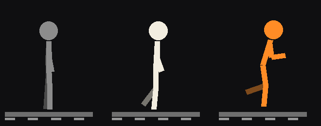

# Windrunner + WalkingPad Control

Walk on your treadmill while you play.

- **WalkingPad Control** (Windows app) — controls a Xiaomi / KingSmith WalkingPad (A1, A1 Pro and other
  "WiLink" models) over Bluetooth, and links it to your games.
- **Windrunner** (World of Warcraft addon) — an in-game walking tracker for **any** treadmill, with a little
  walking / running figure, and optional Hardcore mode.

Demo: https://www.youtube.com/watch?v=BBa3kIVbj6k&t=34s

## Download

- **[WalkingPad.zip](https://github.com/adunis/windrunner-walkingpad-/raw/main/downloads/WalkingPad.zip)** — the Windows app (build 20261111-2205)
- **[Windrunner.zip](https://github.com/adunis/windrunner-walkingpad-/raw/main/downloads/Windrunner.zip)** — the WoW addon (v2.9)

- **App:** unzip and run `WalkingPad.exe`. Windows SmartScreen may warn because it isn't signed:
  *More info → Run anyway*. Close the KS Fit / Mi Home app first — the pad accepts one connection.
- **Addon:** unzip into `World of Warcraft\_retail_\Interface\AddOns` (or `_forever_`, `_classic_era_`…),
  so you get `AddOns\Windrunner\Windrunner.toc`. Or click **Install Windrunner** in the app.

## WalkingPad Control

- Live speed, time, distance, steps; start / stop / speed; Manual / Auto / Standby.
- Pad settings: auto-mode sensitivity, max / start speed, smart start.
- Gaming, one of three:
  - **Belt follows the game** — W walks, W+Shift sprints, gamepad stick = proportional speed. With
    Windrunner in App mode, WoW decides (idle / walk / run / mounted speeds set in-game).
  - **Pad drives the game** — walk forward on the pad in Auto mode and your character walks; faster = sprint.
    In WoW your character switches walk/run to match the belt.
  - **Treadmill only** — games are ignored.
- Closing the window stops the belt and releases held keys; minimising goes to the tray.
- Lab tab: raw Bluetooth messages, for reverse engineering.

## Windrunner (WoW addon)

- Compact window: walking / running figure, time, and *"5.00 km You / 3.00 km Thrall"*.
  Right-click or **+** for controls.
- **Manual mode** — any treadmill: Start / Pause / Stop and set your belt speed.
- **App mode** — WalkingPad Control drives the belt from your character; the session starts when you move.
- **Hardcore** (Manual mode) — movement keys locked unless a session runs. Never in combat.
- **Lore messages** (on by default) — every 0.5 km a line in the spirit of Azeroth appears like a subtitle
  at the bottom of the screen, with your distance. Each class and race has its own lines — a Troll Priest
  hears Priest and Troll lines only — and 5 km milestones follow your faction. Walking and running
  distance are tracked separately. The lines are original, written in the spirit of Azeroth
  (`addon/Windrunner/Lore.lua`).
  `/wr lore` toggles them, `/wr every 1` changes the interval, `/wr testlore` previews one.
- Commands: `/wr`, `/wr history`, `/wr miles`, `/wr warn`, `/wr hardcore`, `/wr lore`, `/wr every <km>`, `/wr testlore`, `/wr sync`, `/wr debug`.
- Works on Retail, Forever and Classic clients.

## How the link works

WoW addons can't talk to other programs, so:

- **Addon → app:** Windrunner (2.9+) draws a small strip of black and white blocks (2 × 19) in the
  top-left corner of WoW, like a tiny barcode with a checksum. The app finds the WoW window on any
  monitor, windowed or fullscreen, and reads it. Pure black / white with a measured threshold works
  through HDR, Night Light, gamma and colour filters, and the blocks scale with the screen (8 px at
  1080p, 16 px on a 4K TV). Keep WoW's top-left corner visible. *Check link* in the app saves a picture
  of what it sees, for troubleshooting. The app still reads the three colour squares of older versions.
- **App → addon:** once a second the app taps F11 / F12 to send the real belt speed, and numpad `/`
  to toggle walk / run. Windrunner binds those keys itself while it's loaded.
- If WoW runs as administrator, Windows blocks the keys unless the app runs as administrator too
  (the app detects this and offers a restart).

## The Bluetooth protocol

KingSmith "WiLink": notify `fe01`, write `fe02`. Frames `F7 … CRC FD`, CRC = sum of the bytes between
start and CRC, mod 256. Status `F7 A2 00 00 00 FD`; mode `F7 A2 02 <0 auto|1 manual|2 standby>`;
speed `F7 A2 01 <km/h×10>`; start `F7 A2 04 01`; settings `F7 A6 <key> 00 <v> <v> <v> CRC FD`
(keys 1–9; the pad answers with all settings). On the A1 Pro there's no Bluetooth command for the beep
or to skip the 3-second start countdown. Built on the work of
[ph4-walkingpad](https://github.com/ph4r05/ph4-walkingpad).

## Flow and UI update (2026-11-11)

- Stop waits for movement to be released before generic follow mode can restart.
  In drive mode, press Start to re-enable movement after Stop.
- Stop cancels commands already waiting for the Bluetooth command gap.
- Shutdown disables game control before stopping; disconnect clears pending commands.
- A missing WoW link retains control ownership instead of falling back to keyboard input.
- Addon Pause overrides a manual app start; drive mode releases keys throughout stopping.
- Windows: Control, Settings, and Diagnostics; only relevant speed controls appear.
  WoW session controls and speeds live in Windrunner, with Stop always available in the app.
- Addon: session controls first, optional speeds/toggles behind Settings, shorter status text.

Validated with 16 regression tests, browser interaction checks at 500/380 px widths,
and Lua syntax checking. WoW rendering and physical belt operation still need live testing.

## Building

### Pixel-link fix (2026-11-10)

Includes the locally updated expanded UI, clearer session status, and Combat Crawl
(toggle with `/wr combat`). Checkbox rows are separated in both modes. The app
accepts the added session/combat flags as well as the original protocol.

Install both the updated Windows app and Windrunner v2.7. The addon draws three
6×6 physical-pixel blocks, recalculated on display/UI-scale changes. The reader
measures their size and samples their centres in one capture; it also reads the
older 3×3 blocks. Missing or corrupted request pixels now mean link loss, rather
than a switch to Manual mode / keyboard control. Screen-capture failures clear
stale readings. Speed changes of exactly 0.1 km/h are no longer skipped by
floating-point rounding.

For diagnosis, use `/wr debug` in WoW and the app's link check. Since 2.9 the link
is a black / white strip (see "How the link works"), so HDR, gamma, Night Light and
any resolution no longer break it; the exact-colour squares are only a fallback for
older addon versions.

Regression checks: `python -m unittest discover -s tests -v`.
Live WoW rendering and physical treadmill operation still require validation.

Windows: run `app\build_exe.bat` (needs Python 3.12). Or run from source:
`pip install bleak aiohttp pywebview pystray pillow` then `python app\walkingpad_app.py`.
`--simulate` runs against a pretend treadmill; `--console` uses the browser instead of a window.

## Safety

Software start commands move the belt. Be on or off the belt deliberately, keep the remote within
reach, and use the pad's physical stop if anything goes wrong. Use at your own risk.

## License

MIT
